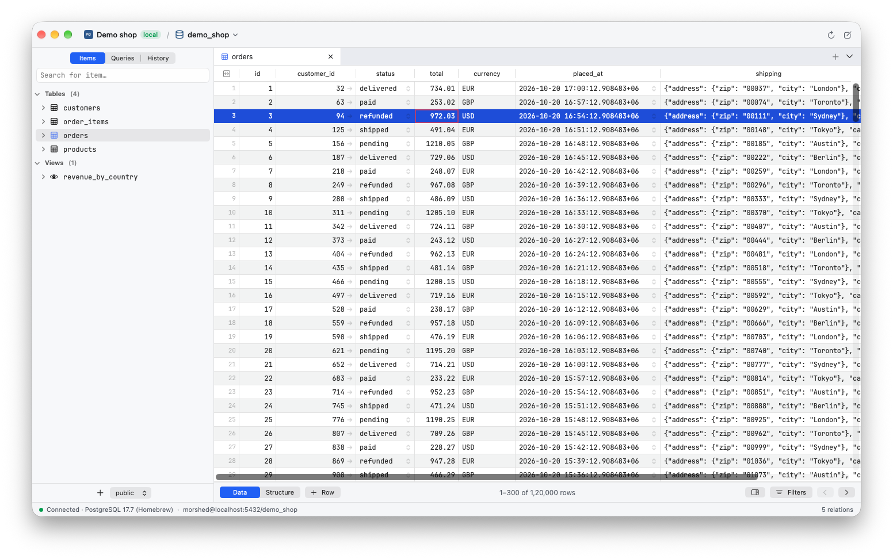
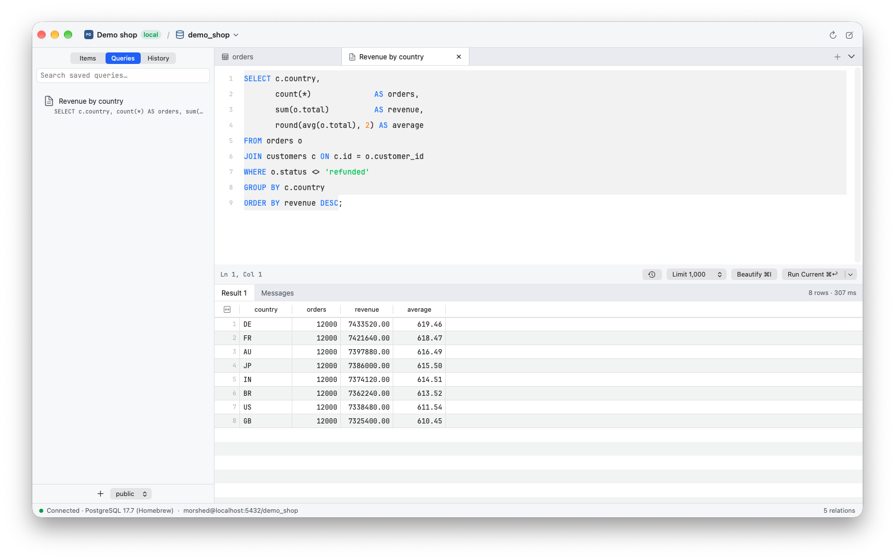
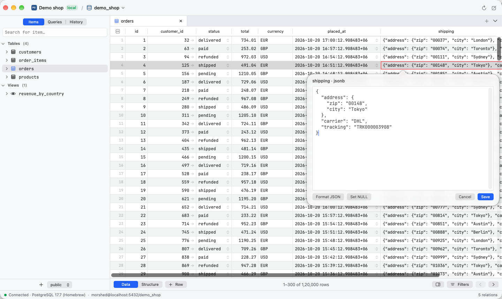
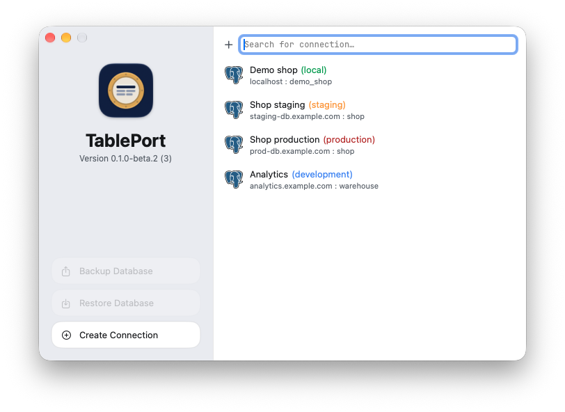

# TablePort

**TablePort is a fast, native database client and database GUI for Mac.**
It works with PostgreSQL, MySQL, MariaDB, SQLite, libSQL and Turso, Redis,
MongoDB, Cassandra and Firestore, with SQL Server, Oracle and Cloudflare D1
in preview. It is free and open source: a lightweight alternative to
TablePlus, Postico and pgAdmin, built with Swift and AppKit on a Rust core.

**Requires macOS 14 Sonoma or later on Apple silicon.**

> **Public beta.** TablePort is new. Try it on development data first, and
> please [report problems](https://github.com/morshedx/tableport/issues/new?template=bug_report.yml).



## Features

- **Databases**: PostgreSQL, MySQL and MariaDB, SQLite files, libSQL and
  Turso, Redis (key tree, value viewers and a console), MongoDB (collections
  as tables, mongo shell commands), Apache Cassandra and Google Cloud
  Firestore. SQL Server and Azure SQL, Oracle Database and Cloudflare D1 are
  in preview: they are built and tested offline but not yet against a live
  server.
- **Connections**: paste a connection URL, TLS (disable, prefer, require,
  verify-full), SSH tunnels with a password or key, colour tags, read-only
  mode. Passwords stay in the macOS Keychain.
- **Data grid**: sort, filter, page through large tables, select cells, edit
  in place or in a cell editor for long text and JSON, follow foreign keys.
- **Safe changes**: edits, new rows and deletes stay pending until you review
  the SQL and commit them in one transaction. Production connections ask first.
- **Query editor**: run the statement under the cursor or everything,
  cancel, beautify, line numbers, errors marked in place, history and saved
  queries.
- **Copy and export**: copy rows as CSV or `INSERT` statements; export a
  table to CSV, JSON or SQL.
- **Fast**: switching between large tables takes about 60–100 ms.

## A TablePlus alternative for Mac

TablePort is for people who want a native Mac database GUI without a
subscription or a heavy Java or Electron app. If you use **TablePlus**,
**Postico**, **pgAdmin**, **DBeaver** or **DataGrip** on a Mac,
TablePort covers the daily work (browse, filter, edit, query, export) and
switches between large tables faster than TablePlus in our tests.

## Screenshots

| Query editor | Cell editor for JSON |
|---|---|
|  |  |



All screenshots use a made-up demo database.

## Install

1. Download the latest `.dmg` from
   [Releases](https://github.com/morshedx/tableport/releases/latest).
2. Open it and drag **TablePort** to **Applications**.
3. The first time, macOS blocks the app because it isn't notarized yet. Open
   **System Settings › Privacy & Security** and click **Open Anyway**.

TablePort updates itself (Settings › Updates).

### Requirements

- macOS 14 Sonoma or later
- A Mac with Apple silicon (M1 or later). Intel Macs are not supported yet.
- PostgreSQL 12 or later
- Oracle Database needs Oracle Instant Client, which you download from Oracle
  and choose in the connection's Instant Client tab

## Build

TablePort is a Swift app (AppKit and SwiftUI) on a Rust core that does all
the database work, connected with [UniFFI](https://mozilla.github.io/uniffi-rs/).

Requirements: Xcode command-line tools, Rust (`rustup`), and mac-kit (the
author's shared build, settings and update kit) checked out next to this
repository. mac-kit is not public yet, so building from source is not possible
outside the author's machine for now.

```sh
make run          # build the Rust core, the app, and open it
make core-test    # Rust tests; needs a local PostgreSQL that trusts your user
make licences     # rebuild the third-party licence file after changing dependencies
```

To sign builds with your own certificate, create `local.mk`:

```make
MACKIT_SIGN = Apple Development: you@example.com (TEAMID1234)
```

## Privacy

Connections, query history and saved queries stay on your Mac. Passwords stay
in the macOS Keychain. TablePort goes online only to reach your own database
servers (for Firestore and Cloudflare D1, Google's and Cloudflare's APIs) and
to check for updates.

## Licence

[Apache-2.0](LICENSE). "TablePort" and its icon are trademarks of the author.
Database names are trademarks of their owners and show only which
database a connection uses; TablePort is not affiliated with or endorsed by
them. Third-party licences are in Settings › About › Licences.
